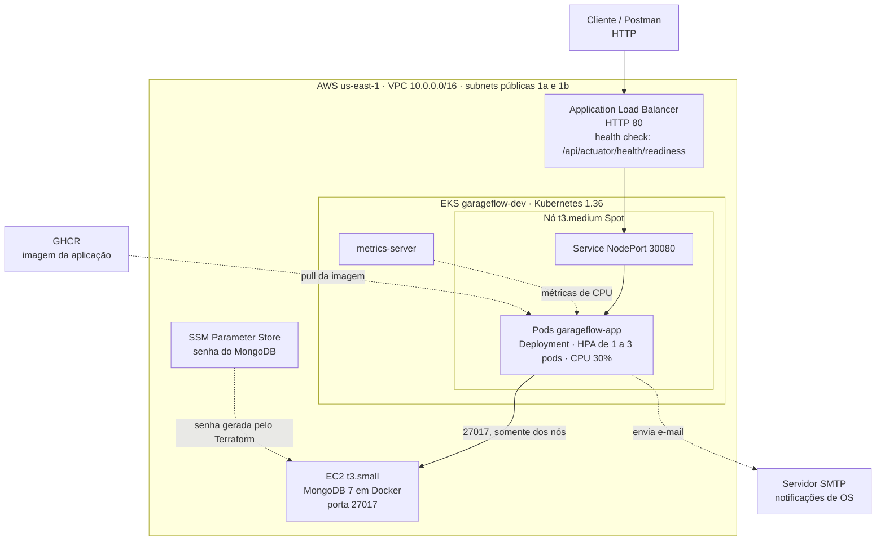
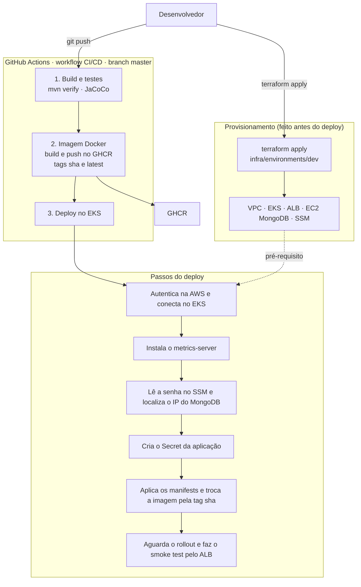
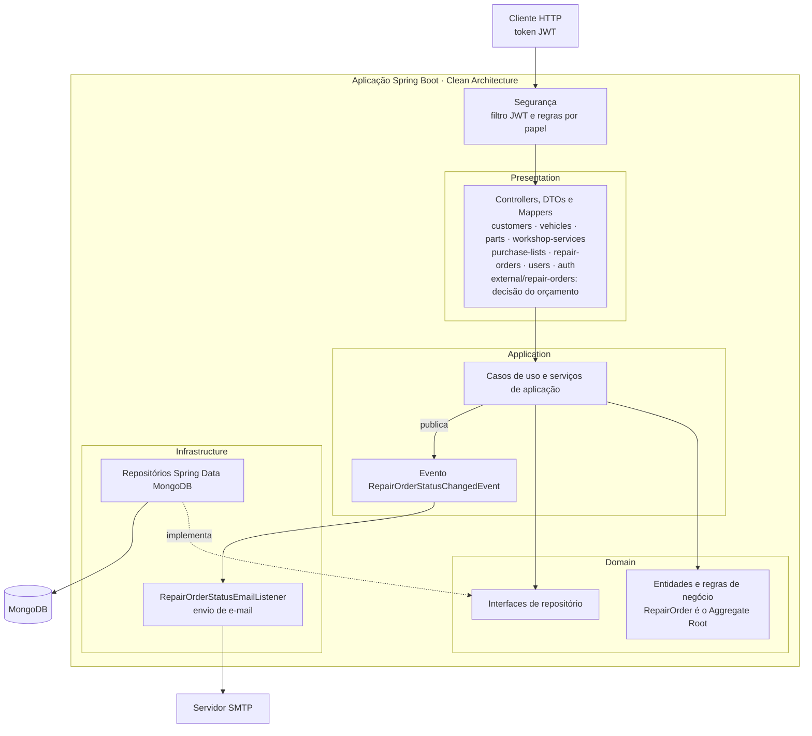

# 🔧 GarageFlow — SOAT 17

> API para gerenciamento de Ordens de Serviço (OS) de uma oficina mecânica, que permitirá aos clientes acompanhar em tempo real o andamento do serviço, autorizar reparos adicionais via aplicativo e garantir uma gestão interna eficiente e segura.

O projeto trata-se de um MVP do sistema de gestão para uma oficina mecânica. Desenvolvida utilizando **Java 25**, **Spring Boot 4**, **MongoDB** e uma organização baseada em **Clean Architecture + DDD**, com foco na **RepairOrder** como Aggregate Root.


## 📊 Visão Geral

### Fluxo Principal da OS

```
┌──────────┐   ┌────────────┐   ┌────────────────┐   ┌──────────┐   ┌──────────────┐   ┌──────────┐   ┌───────────┐
│ RECEIVED │──▶│IN_DIAGNOSIS│──▶│AWAITING_APPROVAL│──▶│ APPROVED │──▶│IN_EXECUTION  │──▶│ FINISHED │──▶│ DELIVERED │
└──────────┘   └────────────┘   └────────────────┘   └──────────┘   └──────────────┘   └──────────┘   └───────────┘
                                       │
                                       ▼
                                   REJECTED
```

### Fluxo de Serviços

Cada serviço segue seu próprio ciclo de vida:

```
WAITING_ATTENDING  ──▶  IN_EXECUTION  ──▶  FINISHED
```

> ⚠️ **Importante**: Quando todos os serviços da OS estão `FINISHED`, a RepairOrder passa automaticamente para esse estado.

## 🎯 Fase 2 — Escalabilidade e Automação

Nesta fase a aplicação da Fase 1 foi evoluída para rodar com **infraestrutura escalável**, **provisionamento automatizado** e **deploy contínuo**.

| Entrega | Onde está | O que faz |
|---------|-----------|-----------|
| Containerização | `Dockerfile` e `docker-compose.yml` | Imagem multi-stage (Java 25) e stack local com MongoDB |
| Orquestração | [`k8s/`](k8s) | Deployment, Service, ConfigMap, Secret e HPA da aplicação |
| Infraestrutura como código | [`infra/`](infra) | Terraform: rede, cluster EKS, Load Balancer e banco MongoDB |
| CI/CD | [`.github/workflows/ci-cd.yaml`](.github/workflows/ci-cd.yaml) | Build, testes, imagem Docker e deploy no cluster |

As seções **Deploy em Kubernetes**, **Infraestrutura com Terraform**, **CI/CD** e **Escalabilidade automática (HPA)**, mais adiante, detalham cada parte.

## 📋 Regras de Domínio

| Regra | Descrição |
|-------|-----------|
| **Diagnóstico** | Uma OS só pode iniciar o diagnóstico quando estiver em `RECEIVED` |
| **Solicitação de Aprovação** | Uma OS só pode solicitar aprovação quando estiver em `IN_DIAGNOSIS` e possuir **no mínimo um serviço** |
| **Aprovação/Rejeição** | Uma OS só pode ser aprovada ou rejeitada quando estiver em `AWAITING_APPROVAL` |
| **Execução** | Uma OS só pode iniciar a execução quando estiver em `APPROVED` |
| **Início de Serviço** | Um serviço só pode ser iniciado quando a OS estiver em `IN_EXECUTION` |
| **Finalização de Serviço** | Um serviço só pode ser finalizado quando estiver em `IN_EXECUTION` |
| **Finalização da OS** | A OS só é finalizada quando **todos** seus serviços estiverem `FINISHED` |
| **Entrega** | Uma OS só pode ser entregue quando estiver em `FINISHED` |
| **Controle de Estoque** | Alterações de peças consultam o estoque e utilizam operações compensatórias em caso de falha |
| **Snapshots** | Peças e serviços adicionados à OS preservam dados relevantes do momento da inclusão |
| **Aprovação de Compra** | Listas de compra só podem ser aprovadas/rejeitadas quando estiverem `PENDING` |
| **Compra de Insumos** | Ao comprar a lista aprovada, o estoque de cada peça é incrementado automaticamente |

## 🏗️ Arquitetura

A estrutura segue a separação de responsabilidades da **Clean Architecture**:

```
src/main/java/br/com/fiap/tech/challeng/garageflow_soat_17_2026_la/
├── customer/                 # Clientes da oficina
├── vehicle/                  # Veículos e placas
├── user/                     # Usuários e autenticação (login JWT)
├── part/                     # Peças e estoque
├── workshopservice/          # Serviços de oficina
├── purchasing/               # Lista de compras e aprovação
├── repairorder/              # Aggregate Root principal (OS, orçamento e e-mails)
└── shared/                   # Segurança (JWT), configuração e tratamento de exceções
```

Cada módulo de negócio é dividido em `application/`, `domain/`, `infrastructure/` e `presentation/`.

### Componentes Principais

- **Domain (Domínio)**: Contém as entidades, value objects e regras de negócio
- **Application (Aplicação)**: Orquestra os casos de uso sem concentrar lógica de negócio
- **Presentation (Apresentação)**: Controllers, DTOs e mappers para exposição HTTP
- **Infrastructure**: Spring Data MongoDB mantém persistência atrás das interfaces de repository

### Arquitetura da solução (Fase 2)

Os diagramas abaixo mostram, nesta ordem, a **infraestrutura provisionada**, o **fluxo de deploy** e os **componentes da aplicação**.

#### Infraestrutura provisionada

O Terraform cria a VPC, o cluster EKS, o Load Balancer, a instância do MongoDB e o parâmetro com a senha do banco ([`infra/`](infra)). A aplicação roda no cluster e acessa o MongoDB pelo IP privado da VPC.



#### Fluxo de deploy

O Terraform é aplicado antes, e a pipeline faz o deploy da aplicação nessa infraestrutura a cada push na `master`.



#### Componentes da aplicação



As dependências apontam para dentro: `presentation` e `infrastructure` dependem de `application` e `domain`. O domínio concentra as regras de negócio e define as interfaces de repositório, que a camada de infraestrutura implementa.

## 🛠️ Tecnologias

| Tecnologia | Versão | Propósito |
|-----------|--------|----------|
| **Java** | 25 | Linguagem principal |
| **Spring Boot** | 4.0.7 | Framework web e IoC |
| **Spring Web** | - | APIs REST |
| **Spring Validation** | - | Validação de dados |
| **Spring Data MongoDB** | - | Persistência de dados |
| **Springdoc OpenAPI** | - | Documentação automática (Swagger) |
| **Lombok** | - | Redução de boilerplate |
| **JUnit 5** | - | Framework de testes |
| **Mockito** | - | Mock objects para testes |
| **MongoDB** | 7 | Banco de dados NoSQL |
| **Maven** | 3.9+ | Gerenciamento de dependências |
| **Docker** | - | Containerização |

> Consulte `pom.xml` para versões específicas de todas as dependências.

## 🚀 Como Executar

### Pré-requisitos

- ✅ **Java 25** ou superior
- ✅ **Maven 3.9+**
- ✅ **Docker** e **Docker Compose**

### 1️⃣ Subir a Stack Completa (MongoDB + Aplicação)

Na raiz do projeto, execute:

```bash
docker compose up -d --build
```

Isso sobe o MongoDB **e** a aplicação em containers. A aplicação estará disponível em `http://localhost:8080/api` e o MongoDB em `localhost:27017`.

**Credenciais padrão (desenvolvimento):**
- Usuário: `admin`
- Senha: `admin123`
- Database: `garageflow-soat-17-2026-db`
- Porta: `27017`

> ⚠️ Sempre que alterar o código, rode novamente com `--build` para que a imagem da aplicação seja reconstruída com as mudanças.

**Variáveis da aplicação:** a aplicação não traz valores padrão para os segredos. O `docker-compose.yml` fornece valores de **desenvolvimento**, então a stack sobe sem configuração. Para usar outros valores, exporte a variável antes do comando ou crie um arquivo `.env` na raiz.

| Variável | Padrão no compose | Para que serve |
|---|---|---|
| `JWT_SECRET` | valor de desenvolvimento | Chave de assinatura dos tokens (mínimo de 32 caracteres) |
| `ADMIN_SEED_PASSWORD` | `admin123` | Senha do usuário administrador `admin@garageflow.com`, criado no primeiro boot |
| `MAIL_PASSWORD` | não definido | Opcional. Sem ela a aplicação sobe, mas as notificações por e-mail não são enviadas |

Login da API: `POST /api/auth/login` com `admin@garageflow.com` e a senha acima.

### 2️⃣ Alternativa — Executar a Aplicação Localmente (fora de container)

Útil para debug. Suba **apenas** o MongoDB em container e rode a aplicação via Maven, apontando para ele:

```bash
docker compose up -d mongodb
```

A aplicação exige `JWT_SECRET` e `ADMIN_SEED_PASSWORD` (sem valor padrão). Exporte-os no mesmo terminal antes de rodar:

```bash
export JWT_SECRET=dev-only-jwt-secret-change-me-0123456789abcdef
export ADMIN_SEED_PASSWORD=admin123
```

Depois, inicie a aplicação com o Maven:

```bash
mvn spring-boot:run
```

A aplicação iniciará em `http://localhost:8080/api`

> ⚠️ Não rode a stack completa (passo 1) e a aplicação local (passo 2) ao mesmo tempo — as duas tentam usar a porta `8080` e vão conflitar.

## ☸️ Deploy em Kubernetes

Os manifestos ficam em [`k8s/`](k8s) e usam o namespace `garageflow`.

| Arquivo | Recurso | O que faz |
|---------|---------|-----------|
| `k8s/namespace.yaml` | Namespace | Isola todos os recursos da aplicação |
| `k8s/app/configmap.yaml` | ConfigMap | Configuração não sensível (opções da JVM e e-mail do administrador) |
| `k8s/app/secret.yaml` | Secret | Variáveis sensíveis (`SPRING_MONGODB_URI`, `JWT_SECRET`, `ADMIN_SEED_PASSWORD`). **Contém apenas valores de exemplo** |
| `k8s/app/deployment.yaml` | Deployment | Executa a imagem da aplicação, com `requests`/`limits` de CPU e memória e probes do Actuator |
| `k8s/app/service.yaml` | Service `NodePort` | Expõe a aplicação na porta `30080` dos nós |
| `k8s/app/hpa.yaml` | HorizontalPodAutoscaler | Escala a aplicação pelo consumo de CPU |

O **banco de dados não é um manifesto Kubernetes**: o MongoDB roda numa instância EC2 provisionada pelo Terraform, e a aplicação o acessa pelo IP privado da VPC.

**Segredos:** o `k8s/app/secret.yaml` é só um modelo. O Secret real é criado pela pipeline a partir dos *secrets* do GitHub e do AWS Systems Manager, e a pipeline **não** aplica esse arquivo. Não aplique o modelo em um ambiente real.

**Probes:** o Deployment usa `startupProbe` e `livenessProbe` em `/api/actuator/health/liveness` e `readinessProbe` em `/api/actuator/health/readiness`.

### Aplicar manualmente

Com o `kubectl` apontando para o cluster, crie primeiro o Secret com valores reais e depois aplique os manifestos:

```bash
kubectl apply -f k8s/namespace.yaml

kubectl create secret generic garageflow-app-secret -n garageflow \
  --from-literal=SPRING_MONGODB_URI='mongodb://admin:<SENHA>@<IP_DO_MONGO>:27017/garageflow-soat-17-2026-db?authSource=admin' \
  --from-literal=JWT_SECRET='<MINIMO_32_CARACTERES>' \
  --from-literal=ADMIN_SEED_PASSWORD='<SENHA_DO_ADMIN>'

kubectl apply -f k8s/app/configmap.yaml -f k8s/app/service.yaml -f k8s/app/hpa.yaml -f k8s/app/deployment.yaml
kubectl rollout status deployment/garageflow-app -n garageflow
kubectl get pods,svc,hpa -n garageflow
```

A imagem do Deployment é `ghcr.io/lucas01pl/garageflow-soat-17-2026-la:latest`. A pipeline a troca pela tag do commit (SHA) a cada deploy. O HPA depende do `metrics-server` instalado no cluster (a pipeline o instala).

## 🏗️ Infraestrutura com Terraform

Os scripts ficam em [`infra/`](infra): o ambiente em `infra/environments/dev` e os componentes em `infra/modules`. O guia completo, com pré-requisitos, custos, segurança e destruição do ambiente, está em **[`infra/README.md`](infra/README.md)**.

| Módulo | Recursos criados |
|--------|------------------|
| `vpc` | VPC `10.0.0.0/16`, duas subnets públicas, Internet Gateway e rotas |
| `eks` | Cluster `garageflow-dev` (Kubernetes 1.36), Managed Node Group com uma instância `t3.medium` Spot, roles do IAM e Security Groups |
| `alb` | Application Load Balancer público (HTTP/80) com target group na `NodePort 30080` e health check em `/api/actuator/health/readiness` |
| `mongo` | Instância EC2 `t3.small` com MongoDB 7 em Docker, Security Group que só aceita os nós do EKS e senha aleatória guardada no SSM Parameter Store |

O plano cria **35 recursos**. Todos recebem as tags `Project=garageflow` e `Environment=dev`, o que facilita localizar sobras depois do `destroy`.

### Provisionar

```bash
cd infra/environments/dev
terraform init
terraform plan -var="admin_role_arn=arn:aws:iam::<ID_DA_CONTA>:user/<USUARIO_OU_ROLE>" -out=tfplan
terraform apply tfplan
```

O `admin_role_arn` é o usuário ou a role IAM que administrará o cluster. Também pode ficar num arquivo local `terraform.tfvars`, que está no `.gitignore`. Ao final, `terraform output alb_dns_name` mostra o endereço da API: `http://<alb_dns_name>/api`.

### Destruir

```bash
terraform destroy -var="admin_role_arn=arn:aws:iam::<ID_DA_CONTA>:user/<USUARIO_OU_ROLE>"
```

> ⚠️ **Custos:** o cluster EKS, o Load Balancer e as instâncias cobram por hora enquanto existirem. Destrua o ambiente ao terminar. O estado do Terraform (`terraform.tfstate`) fica local e contém a senha do banco: não o apague antes do `destroy` e não o versione.

## 🔁 CI/CD

O workflow **CI/CD** ([`.github/workflows/ci-cd.yaml`](.github/workflows/ci-cd.yaml)) roda em *push* e *pull request* na branch `master`, e também manualmente (*Run workflow*).

| Job | O que faz | Roda em PR? |
|-----|-----------|-------------|
| **Build e testes** | `mvn verify` (Java 25, MongoDB de serviço, cobertura mínima do JaCoCo) | Sim |
| **Imagem Docker** | Constrói a imagem e publica no GHCR com as tags `<sha>` e `latest` | Constrói, mas não publica |
| **Deploy no EKS** | Conecta no cluster, instala o `metrics-server`, cria o Secret, aplica os manifestos, troca a imagem, espera o rollout e executa o *smoke test* pelo Load Balancer | Não |

O *smoke test* verifica o `readiness` da aplicação e faz o login do administrador, o que prova que os Secrets e o banco estão funcionando.

**Secrets necessários** (Settings → Secrets and variables → Actions):

| Secret | Uso |
|--------|-----|
| `AWS_ACCESS_KEY_ID` e `AWS_SECRET_ACCESS_KEY` | Autenticar na AWS (o usuário precisa ser o administrador do cluster) |
| `JWT_SECRET` | Chave de assinatura dos tokens (mínimo de 32 caracteres) |
| `ADMIN_SEED_PASSWORD` | Senha do usuário administrador |

A senha do MongoDB **não** é um secret do GitHub: o Terraform a gera e a pipeline a lê do SSM Parameter Store. O job de deploy exige que o `terraform apply` já tenha sido feito, porque ele localiza o cluster, o Load Balancer e a instância do banco pelos nomes.

O pacote da imagem no GHCR precisa estar **público** para o cluster baixá-la sem credencial.

## 📈 Escalabilidade automática (HPA)

O [`k8s/app/hpa.yaml`](k8s/app/hpa.yaml) escala a aplicação de **1 a 3 pods** quando a CPU média passa de **30% do valor solicitado** (`200m` por pod, ou seja, 60m). Ao cair a carga, a redução espera 60 segundos de estabilização.

O HPA usa **apenas CPU**. Uma métrica de memória foi descartada de propósito: a JVM mantém cerca de 60% do `request` de memória em repouso, o que impediria o HPA de voltar a 1 pod depois da carga.

O HPA altera o número de **pods**, não o de nós: o grupo de nós tem uma única instância `t3.medium`, dimensionada para comportar os 3 pods. Se o nó não tiver capacidade, os pods excedentes ficam `Pending`.

### Ver o HPA em ação

Em um terminal, acompanhe o HPA e, em outro, os pods:

```bash
kubectl get hpa -n garageflow -w
kubectl get pods -n garageflow -w
```

Gere carga com um pod temporário dentro do cluster. O login consome CPU por causa do BCrypt, então mesmo com senha inválida a carga é eficaz:

```bash
kubectl run load -n garageflow --image=curlimages/curl:8.10.1 --restart=Never --command -- sh -c \
  'for i in 1 2 3 4 5 6 7 8; do (while true; do curl -s -o /dev/null -X POST http://garageflow-app:8080/api/auth/login -H "Content-Type: application/json" -d "{\"email\":\"x@x.com\",\"password\":\"x\"}"; done) & done; wait'
```

Em poucos segundos a CPU passa de 30% e o número de réplicas sobe. Para encerrar a carga e ver a redução:

```bash
kubectl delete pod load -n garageflow
```

## ✅ Testes

### Executar Todos os Testes

```bash
mvn test
```

Nota rápida: a suíte de testes exige JDK 25 (projeto target=25). Se o ambiente local tiver JDK diferente, ajuste a instalação ou toolchain antes de executar os testes. Alguns testes unitários dependem do SecurityContext contendo um `AuthenticatedUser` (os testes do repositório já populam esse contexto automaticamente). Para testes manuais que exercitam endpoints protegidos, gere um token via `/auth/login` e envie em `Authorization: Bearer <token>` (o token agora inclui `userId`).


### Cobertura de Testes

A suíte contém cobertura completa:

✓ Testes de domínio  
✓ Casos de uso  
✓ Services e orquestração  
✓ Mappers e conversão de dados  
✓ Repositories e persistência  
✓ Controllers e APIs  
✓ Validações e exceções  

### Comportamentos Testados

- ✅ Transições de estado da OS
- ✅ Regras de quantidade e validação
- ✅ Inclusão e remoção de peças
- ✅ Controle de estoque
- ✅ Inclusão e remoção de serviços
- ✅ Finalização de serviços
- ✅ Finalização automática da OS
- ✅ Mapeamentos entre camadas
- ✅ Integração com MongoDB

## 📡 API REST

Os módulos da aplicação seguem uma API REST organizada por domínio. Além da RepairOrder, o projeto agora inclui autenticação, usuários, clientes, veículos, peças, serviços e compras.

### Autenticação e Usuários

| Método | Endpoint | Descrição                                                                         |
|--------|----------|-----------------------------------------------------------------------------------|
| `POST` | `/auth/login` | Autentica um usuário e retorna JWT                                                |
| `POST` | `/users` | Cria um usuário                                                                   |
| `GET` | `/users/{id}` | Busca usuário por ID                                                              |
| `GET` | `/users?fullName=...` | Busca usuários por nome ou lista todos os usuários caso o nome não seja informado |
| `PUT` | `/users/{id}` | Atualiza usuário                                                                  |
| `DELETE` | `/users/{id}` | Remove usuário                                                                    |

**Nota sobre autenticação:** os tokens JWT incluem agora o claim `userId`. Os controllers extraem o usuário autenticado via resolveCurrentUserId() (em `shared.presentation.controller.BaseController`) e esperam o principal como `AuthenticatedUser` com `userId` e `email`. Ao testar endpoints protegidos manualmente, inclua o header `Authorization: Bearer <token>` retornado por `/auth/login`. Nos testes unitários, o SecurityContext é populado com `AuthenticatedUser` para simular autenticação.

### Clientes e Veículos

| Método | Endpoint              | Descrição                                                                                  |
|--------|-----------------------|--------------------------------------------------------------------------------------------|
| `POST` | `/customers`            | Cria cliente                                                                               |
| `GET` | `/customers/{id}`       | Busca cliente por ID                                                                       |
| `GET` | `/customers?{document}` | Busca cliente por documento ou lista todos os clientes caso o documento não seja informado |
| `PUT` | `/customers/{id}`       | Atualiza cliente                                                                           |
| `DELETE` | `/customers/{id}`       | Remove cliente                                                                             |
| `POST` | `/vehicles`           | Cria veículo                                                                               |
| `GET` | `/vehicles/{id}`      | Busca veículo por ID                                                                       |
| `GET` | `/vehicles?{plate}`   | Busca veículo por placa ou lista todos os veículos caso a placa não seja informada         |
| `PUT` | `/vehicles/{id}`      | Atualiza veículo                                                                           |
| `DELETE` | `/vehicles/{id}`      | Remove veículo                                                                             |

### Peças e Estoque

| Método | Endpoint                                      | Descrição                                                                      |
|--------|-----------------------------------------------|--------------------------------------------------------------------------------|
| `POST` | `/parts`                                      | Cria peça                                                                      |
| `POST` | `/parts/{id}/stock/debit?quantityToDebit=...` | Debita estoque                                                                 |
| `POST` | `/parts/{id}/stock/add?quantityToAdd=...`     | Acrescenta estoque                                                             |
| `GET` | `/parts/{id}`                                 | Busca peça por ID                                                              |
| `GET` | `/parts?{code}`                               | Busca peça por código ou lista todas as peças caso o código não seja informado |
| `GET` | `/parts/low-stock?threshold=...`              | Lista peças em estoque baixo                                                   |
| `PUT` | `/parts/{id}`                                 | Atualiza peça                                                                  |
| `DELETE` | `/parts/{id}`                                 | Remove peça                                                                    |

### Serviços da Oficina

| Método | Endpoint                                   | Descrição                                                                          |
|--------|--------------------------------------------|------------------------------------------------------------------------------------|
| `POST` | `/workshop-services`                        | Cria serviço                                                                       |
| `GET` | `/workshop-services/{id}`                   | Busca serviço por ID                                                               |
| `GET` | `/workshop-services?description=...` | Busca por descrição ou lista todos os serviços caso a descrição não seja informada |
| `PUT` | `/workshop-services/{id}`                   | Atualiza serviço                                                                   |
| `DELETE` | `/workshop-services/{id}`                   | Remove serviço                                                                     |

### Compras e Estoque

| Método | Endpoint | Descrição |
|--------|----------|-----------|
| `POST` | `/purchase-lists` | Gera lista de compra |
| `GET` | `/purchase-lists` | Lista listas de compra |
| `GET` | `/purchase-lists/{id}` | Busca lista por ID |
| `PATCH` | `/purchase-lists/{id}/approve` | Aprova lista |
| `PATCH` | `/purchase-lists/{id}/reject` | Rejeita lista |
| `POST` | `/purchase-lists/{id}/purchase` | Confirma compra e repõe estoque |

### Ordens de Serviço

| Método   | Endpoint                                                                                   | Descrição                              |
|----------|--------------------------------------------------------------------------------------------|----------------------------------------|
| `POST`   | `/repair-orders`                                                                           | Cria uma nova OS (requer autenticação) |
| `GET`    | `/repair-orders/{id}`                                                                      | Obtém OS por ID                        |
| `GET`    | `/repair-orders`                                                                           | Lista as OS em andamento (exclui as finalizadas e entregues) |
| `GET`    | `/repair-orders/customer/{customerId}`                                                     | Busca OS por cliente                   |
| `POST`   | `/repair-orders/{repairOrderId}/workshop-services`                                         | Adiciona um serviço                    |
| `DELETE` | `/repair-orders/{repairOrderId}/workshop-services/{workshopServicesId}`                    | Remove um serviço                      |
| `POST`   | `/repair-orders/{repairOrderId}/parts`                                                     | Adiciona uma peça                      |
| `DELETE` | `/repair-orders/{repairOrderId}/parts/{partId}`                                            | Remove uma peça                        |
| `PATCH`  | `/repair-orders/{repairOrderId}/status/in-diagnosis`                                       | Inicia diagnóstico                     |
| `PATCH`  | `/repair-orders/{repairOrderId}/status/awaiting-approval`                                  | Solicita aprovação                     |
| `PATCH`  | `/repair-orders/{repairOrderId}/status/approved`                                           | Aprova a OS                            |
| `PATCH`  | `/repair-orders/{repairOrderId}/status/rejected`                                           | Rejeita a OS                           |
| `PATCH`  | `/repair-orders/{repairOrderId}/status/in-execution`                                       | Inicia execução                        |
| `PATCH`  | `/repair-orders/{repairOrderId}/status/delivered`                                          | Entrega a OS                           |
| `PATCH`  | `/repair-orders/{repairOrderId}/workshop-services/{workshopServiceId}/status/in-execution` | Inicia serviço                         |
| `PATCH`  | `/repair-orders/{repairOrderId}/workshop-services/{workshopServiceId}/status/finished`     | Finaliza serviço                       |
| `PATCH`  | `/repair-orders/{repairOrderId}/status/cancelled`                                          | Cancela OS                             |
| `GET`    | `/repair-orders/monitoring/workshop-services/average-execution-time`                       | Calcula tempo médio de execução        |
| `POST`   | `/external/repair-orders/budget-decision`                                                  | Aprova ou rejeita o orçamento (**público**, exige o token do e-mail) |

#### Aprovação do orçamento por notificação externa

Quando a OS passa para `AWAITING_APPROVAL`, a aplicação gera um **token de uso único** e o envia ao cliente por e-mail, junto com os itens do orçamento e os botões **Aprovar** e **Rejeitar**. O cliente decide sem precisar de login, pelo endpoint público `POST /external/repair-orders/budget-decision`.

```bash
curl -X POST http://localhost:8080/api/external/repair-orders/budget-decision \
  -d "token=<TOKEN_RECEBIDO_POR_EMAIL>" \
  -d "approved=true"
```

| Campo | Tipo | Descrição |
|-------|------|-----------|
| `token` | texto, obrigatório | Token enviado no e-mail |
| `approved` | `true` ou `false`, obrigatório | `true` aprova (`APPROVED`) e `false` rejeita (`REJECTED`) |

O corpo é `application/x-www-form-urlencoded`, o mesmo formato enviado pelos botões do e-mail. As respostas são:

| Situação | Resposta |
|----------|----------|
| Decisão registrada | `200` com `{"message": "Orçamento aprovado com sucesso."}` (ou `"Orçamento rejeitado com sucesso."`) |
| `token` ou `approved` ausentes | `400` |
| OS que não está em `AWAITING_APPROVAL` | `400` |
| Token inválido, expirado ou já utilizado | `401` |

**Sobre o token:** são 32 bytes aleatórios; o banco guarda apenas o **hash SHA-256**, nunca o token; vale por **7 dias** e só pode ser usado **uma vez**.

**Sobre o e-mail:**
- A cada mudança de status da OS a aplicação publica um evento, e o cliente recebe uma notificação por e-mail. O envio é **assíncrono**: uma falha do servidor de e-mail é registrada em log e **não impede** a mudança de status.
- Se o cliente não tem e-mail cadastrado, o envio é ignorado.
- O link dos botões usa o endereço público definido em `APP_PUBLIC_BASE_URL` (na pipeline, o DNS do Load Balancer).
- É preciso configurar as credenciais do servidor SMTP (veja as variáveis em **Como Executar**). Sem elas a aplicação funciona, mas nenhum e-mail é enviado.

Um operador autenticado também pode aprovar ou rejeitar diretamente por `PATCH /repair-orders/{id}/status/approved` e `.../rejected`.

Autenticação e criação de OS

- Ao efetuar login via `/auth/login` o JWT agora inclui o claim `userId` (além de email e role). Os controllers leem o usuário autenticado do SecurityContext e persistem o `userId` associado à OS.

Exemplo (gerar token):

```bash
curl -s -X POST http://localhost:8080/api/auth/login \
  -H "Content-Type: application/json" \
  -d '{"email":"admin@example.com", "password":"admin123"}'
```

O retorno contém o token JWT. Para criar uma OS usando o usuário autenticado, envie o header Authorization:

```bash
curl -X POST http://localhost:8080/api/repair-orders \
  -H "Authorization: Bearer <token>" \
  -H "Content-Type: application/json" \
  -d '{"vehicleId":"<vehicle-id>", "customerId":"<customer-id>"}'
```

Notas importantes:
- Se o token não contiver `userId`, a criação falhará. O fluxo de login (`/auth/login`) já inclui `userId` no token gerado.
- Nos testes unitários, o SecurityContext é preenchido com um `AuthenticatedUser` (contendo userId e email) para simular autenticação.

### 📖 Documentação Interativa

Com a aplicação em execução:

- **Swagger UI**: http://localhost:8080/api/docs
- **Especificação OpenAPI**: http://localhost:8080/api/openapi

## 🗄️ MongoDB com Docker

O `docker-compose.yml` configura um container MongoDB com persistência:

```yaml
mongodb:
  ├─ Porta: 27017
  ├─ Usuário: admin
  ├─ Senha: admin123
  ├─ Database: garageflow-soat-17-2026-db
  └─ Volume: Persistência local
```

> ⚠️ **Nota de Segurança**: As credenciais acima são **apenas para desenvolvimento local**. Altere-as antes de usar em produção.

## 🎯 Decisões de Domínio

### Snapshots

A OS mantém snapshots de **cliente**, **veículo**, **peças** e **serviços**.

**Objetivo**: Preservar as informações utilizadas na OS, mesmo que os dados de origem sejam alterados posteriormente.

### Exceções de Negócio

As regras são expressas através de exceções específicas:

```
InvalidRepairOrderStateException
InvalidRepairOrderItemException
InvalidPartException
PartNotFoundException
WorkshopServiceNotFoundException
InsufficientQuantityException
PartStockOperationException
```

O tratamento HTTP é centralizado pelo mecanismo global de exceções da aplicação.

### Controle de Estoque

```
Adicionar Peça:
  1. Verifica disponibilidade em estoque
  2. Debita o estoque
  3. Adiciona peça à OS
  ❌ Se falha: Compensa (recompõe estoque)

Remover Peça:
  1. Recompõe o estoque
  2. Remove peça da OS
  ❌ Se falha: Compensa (debita novamente)
```

Essa abordagem reduz riscos de inconsistência entre estoque e OS sem introduzir, neste momento, uma transação distribuída.

## 📁 Estrutura dos Testes

Os testes acompanham a estrutura das camadas do sistema:

```
src/test/java/br/com/fiap/tech/challenge/garageflow_soat_17_2026_la/
├── repairorder/
│   ├── application/        # Testes de casos de uso
│   ├── domain/             # Testes de regras de negócio
│   └── presentation/       # Testes de controllers
├── part/                   # Testes do domínio de peças
└── workshopservice/        # Testes do domínio de serviços
```

### Cobertura De Casos

Todos os principais comportamentos possuem cobertura de **sucesso** e **falha**:

- ✅ Transições de estado
- ✅ Regras de quantidade e validação
- ✅ Inclusão e remoção de peças
- ✅ Controle de estoque com compensação
- ✅ Inclusão e remoção de serviços
- ✅ Finalização de serviços
- ✅ Finalização automática da OS
- ✅ Mapeamentos entre camadas
- ✅ Integração com repositórios
- ✅ Endpoints de controller
## 🔄 Fluxo de Negócio Completo

### Cenário de Aprovação (Sucesso)

```
1️⃣  Cliente/Veículo selecionados
    ↓
2️⃣  RepairOrder criada (RECEIVED)
    ↓
3️⃣  Diagnóstico iniciado (IN_DIAGNOSIS)
    ↓
4️⃣  Serviços e peças adicionados
    ↓
5️⃣  OS enviada para aprovação (AWAITING_APPROVAL) e e-mail com o token ao cliente
    ↓
6️⃣  Cliente aprova pelo link do e-mail (APPROVED)
    ↓
7️⃣  Execução iniciada (IN_EXECUTION)
    ↓
8️⃣  Serviços executados
    ↓
9️⃣  Serviços finalizados (todos FINISHED)
    ↓
🔟 OS finalizada automaticamente (FINISHED)
    ↓
1️⃣1️⃣ Veículo entregue (DELIVERED)
```

### Cenário de Rejeição (Alternativo)

```
AWAITING_APPROVAL
    ↓
Cliente não aprova
    ↓
REJECTED
```

> ℹ️ Uma OS rejeitada não retorna ao fluxo de diagnóstico. Para um novo atendimento, deve ser criada uma nova OS.

## ℹ️ Status do Projeto

Projeto acadêmico desenvolvido para o **Tech Challenge da Pós-Tech FIAP**.

### Foco Principal

- ✅ Clean Architecture
- ✅ Domain-Driven Design (DDD)
- ✅ Aggregate Root (RepairOrder)
- ✅ Regras de domínio bem definidas
- ✅ API REST
- ✅ Testes unitários abrangentes
- ✅ MongoDB
- ✅ Controle de estoque com compensação
- ✅ Docker e Docker Compose

## 📜 Licença

Este projeto foi desenvolvido para fins acadêmicos no contexto do **Tech Challenge da FIAP**.

---

**Desenvolvido com ❤️ pela equipe do SOAT 17**
